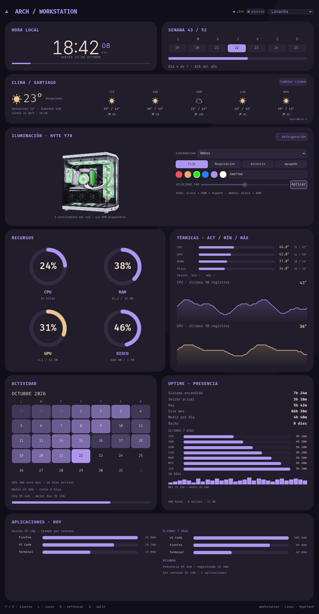

# Unix Dashboard

Dashboard nativo para Linux/Hyprland, construido con Qt Quick y un backend Python.
Incluye reloj, clima, recursos, temperaturas, actividad, aplicaciones, refrigeración
e iluminación física mediante OpenRGB.



*Captura de la interfaz con datos de ejemplo y sin servicios de hardware.*

## Estado

Proyecto personal funcional, todavía adaptado a dos monitores y a un equipo con
ASRock X870 Pro RS, ARCTIC, HUB KRONOS, RAM Corsair y HyperX QuadCast S.
El RGB y los sensores de otros equipos necesitan detección y configuración propias.
La ilustración del HYTE Y70 se generó a partir de fotos del equipo; es un recurso
visual, no una representación exacta de las conexiones físicas.

## Instalación en Arch Linux

Dependencias principales:

```bash
sudo pacman -S --needed python python-pip qt6-base qt6-declarative qt6-quick3d \
  qt6-wayland wayland wayland-protocols gcc pkgconf openrgb
./install.sh
~/.config/unix-dashboard/start.sh
```

El módulo nativo requiere el protocolo `ext-background-effect-v1` y las cabeceras
privadas de Qt incluidas por los paquetes de desarrollo de la distribución.
`install.sh` compila el lanzador e instala la dependencia Python en un directorio
privado. Conserva los ajustes existentes. No activa velocidades de ventilador ni
cambia colores al instalar. La función de terminal opcional usa kitty, btop, cava
 y fastfetch; la interfaz principal no los necesita.

## Uso

- **T / P**: ajustes de temas, transparencias, intervalos y efectos.
- **L**: alternar rayos. **R**: actualizar. **Q**: cerrar.
- El botón de la tarjeta HYTE Y70 alterna Refrigeración / Iluminación.
- Los cambios de iluminación física se envían con **Aplicar**.
- **Todo** incluye placa, RAM y HyperX; **Ambos** incluye placa y RAM.
- ASRock usa una escala de velocidad invertida. La RAM ofrece tres niveles reales.
- El HyperX recibe efectos por software a 10 Hz mediante un servidor OpenRGB local
  en `127.0.0.1:6743`, iniciado bajo demanda.

## Refrigeración opcional

Leer [fan-control/LEEME.md](fan-control/LEEME.md) antes de instalar el servicio:

```bash
sudo bash fan-control/install.sh
```

Los canales se seleccionan manualmente. Los seis ventiladores del HUB KRONOS
comparten RGB por ADDR_LED3; eso no demuestra que compartan PWM con la ARCTIC.
La instalación normal del dashboard no requiere reinstalar este servicio.

## Integración con Hyprland / Caelestia

La instalación activa usa una regla de ventana para `ARCH // WORKSTATION`, en el
monitor vertical DP-5. Su escritorio lógico 1 corresponde al workspace 11 porque
la configuración local asigna los workspaces 11–20 a ese monitor.
Esta regla y el resto de ajustes del escritorio no se instalan automáticamente.

El auxiliar `scripts/wallpaper-pause.py` pausa los fondos de Aura por monitor cuando
hay una aplicación visible, exceptuando el dashboard transparente. Sus sockets se
buscan en `$XDG_RUNTIME_DIR/aura/mpv_*.sock`. Para iniciarlo:

```bash
systemctl --user start game-wallpaper-pause.service
```

Añadir ese comando al inicio de la sesión si se quiere ejecución automática.
Los vídeos de wallpaper no se incluyen: deben elegirse por separado en Aura.

## Regenerar la captura

```bash
QT_QPA_PLATFORM=offscreen QT_QUICK_BACKEND=software \
  /usr/lib/qt6/bin/qmltestrunner -input docs/preview -o -,txt
```

Usa datos simulados; no lee tu historial ni aplica cambios al hardware.

## Pruebas

```bash
QT_QPA_PLATFORM=offscreen QT_QUICK_BACKEND=software \
  /usr/lib/qt6/bin/qmltestrunner -input tests/qml -o -,txt
python3 -m compileall -q . -x 'vendor|.git'
bash -n install.sh start.sh native/build.sh fan-control/install.sh
```

Las pruebas QML no cambian la iluminación ni la velocidad del hardware.

## Datos y Git

La actividad se guarda en `~/.local/share/unix-dashboard/usage.db` y los ajustes en
`~/.config/unix-dashboard`. No forman parte del repositorio. `.gitignore` excluye
ajustes, historiales, binarios compilados, cachés y dependencias.

No se ha elegido todavía una licencia de publicación. Antes de publicar, decidir
la licencia y revisar las licencias de dependencias y recursos.
